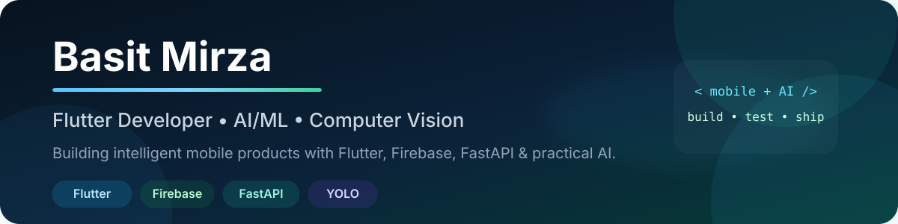

  

  
  &nbsp;
  
  &nbsp;
  

## About Me

I’m a developer focused on building **intelligent mobile applications** where polished Flutter experiences meet practical AI, computer vision and backend services.

-  **Mobile:** Flutter and Dart applications with responsive, production-style UI
-  **Cloud & Auth:** Firebase Authentication, Firestore and Google Sign-In
-  **Backend:** Python APIs with FastAPI and clean mobile API integration
-  **AI / Vision:** YOLO, OpenCV, Google ML Kit and AI-assisted app workflows
-  **Engineering:** Testing, documentation, CI and secure public-repository preparation

## Languages & Tools

  
  &nbsp;&nbsp;
  
  &nbsp;&nbsp;
  
  &nbsp;&nbsp;
  
  &nbsp;&nbsp;
  
  &nbsp;&nbsp;
  
  &nbsp;&nbsp;
  
  &nbsp;&nbsp;
  
  &nbsp;&nbsp;
  

### Tech Stack at a Glance

| Area | Technologies |
| --- | --- |
| **Mobile Development** | Flutter, Dart, Android |
| **AI / Computer Vision** | YOLO, OpenCV, Google ML Kit, Gemini-assisted workflows |
| **Backend / APIs** | Python, FastAPI, REST, multipart media processing |
| **Cloud / Data** | Firebase Auth, Firestore, local user-scoped persistence |
| **Engineering** | Git, GitHub Actions, testing, documentation, secure publication workflows |

## Selected Work

<table>
  <tr>
    <td width="50%" valign="top">
      <h3 align="center">FoodLens AI</h3>
      

        
      

      

        AI-powered Flutter food assistant for ingredient scanning, nutrition tracking,
        smart recipes, pantry management and meal planning.
      

      
<strong>Flutter • Firebase • FastAPI • Gemini • USDA FoodData Central</strong>

      

        
      

    </td>
    <td width="50%" valign="top">
      <h3 align="center">AI Guard</h3>
      

        
      

      

        Examination-monitoring system combining local ML Kit signals with remote
        YOLO image/video analysis, Firebase authentication and a FastAPI backend.
      

      
<strong>Flutter • Firebase • Python • FastAPI • YOLO • OpenCV • ML Kit</strong>

      

        
      

    </td>
  </tr>
</table>

## What I’m Focused On

- Building polished **Flutter applications** with clear architecture and responsive UX
- Integrating **AI and computer vision** into useful mobile product flows
- Connecting mobile clients to **FastAPI** services safely and reliably
- Designing **Firebase authentication and data workflows**
- Improving testing, documentation and deployment quality across portfolio projects

## Portfolio Principles

> Build features that work. Document what is real. Test what matters. Keep the public repository clean.

  

